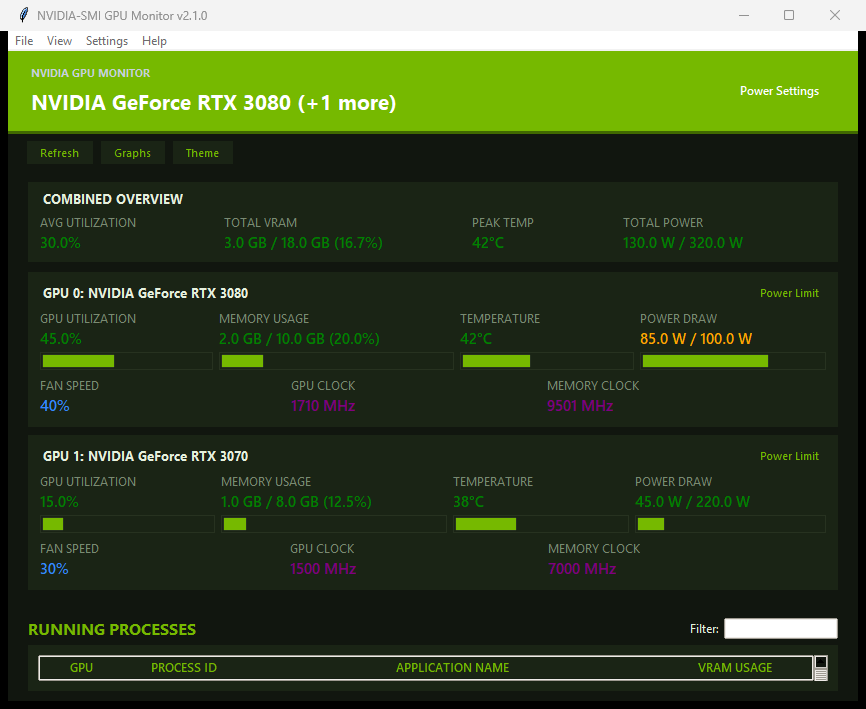
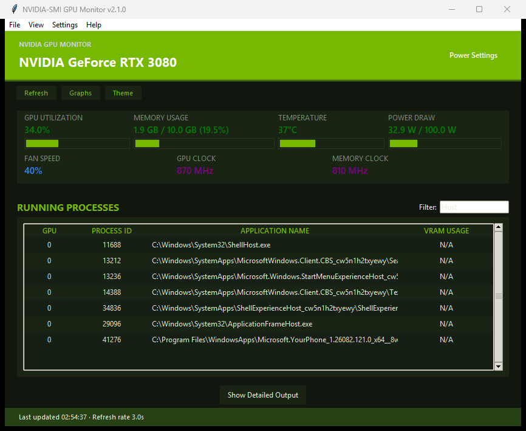
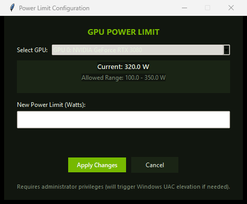
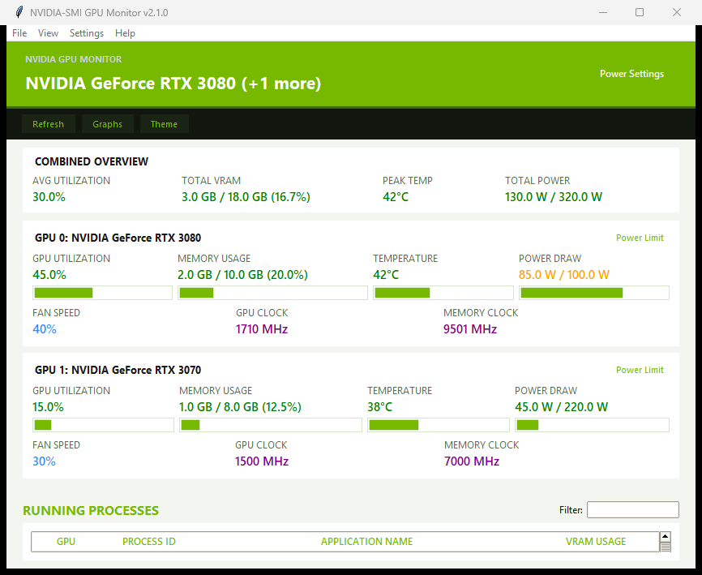

# NVIDIA-SMI GUI Monitor

A real-time graphical interface for monitoring NVIDIA GPU status using `nvidia-smi`, with color-coded metrics, multi-GPU support, process table filtering, and power limit adjustment.



## Overview

This application provides a user-friendly GUI that displays key NVIDIA GPU information in real-time, updating every 2-3 seconds. It is built with Python's Tkinter library and uses the `nvidia-smi` command to fetch GPU status and running processes.

## Features

- 🔄 **Real-time monitoring** - Fast, configurable periodic updates
- 🎨 **Color-coded display** - Visual indicators for utilization, memory, temperature, and power draw
- 🖥️ **Multi-GPU support** - Dedicated card per GPU plus an aggregate combined overview
- 📊 **Process monitoring & search** - Table of running GPU processes with instant search filter, PID/name copying, and task termination
- ⚡ **Power limit control** - Adjust per-GPU power limits with min/max validation (supports polkit `pkexec` on Linux and UAC elevation on Windows)
- 💻 **Laptop & cloud resilience** - Defensive parsing for `[N/A]` and `[Not Supported]` fields (e.g. mobile GPU fans or power limits)
- 📋 **Full nvidia-smi output** - Collapsible section showing complete nvidia-smi information
- 🛡️ **Error handling** - Graceful handling of missing drivers, unsupported commands, or timeouts
- 📈 **History graphs, tray icon, alerts and CSV/JSON export** - available when optional `matplotlib`, `pystray`/`pillow` and `plyer` packages are installed
- 🌐 **Windows and Linux** - macOS is not supported: current Macs have no NVIDIA driver or `nvidia-smi`
- 🪶 **Lightweight** - the core runs on the Python standard library alone; extras are optional (`pip install -r requirements.txt`)

## Screenshots

| Multi-GPU & Combined Overview | Process Table Search & Filter |
|:---:|:---:|
|  |  |

| Power Limit Configuration (Multi-GPU) | Light Theme |
|:---:|:---:|
|  |  |

## Project Structure

```
nvidia-smi-tk/
├── App.py              # Main Tkinter desktop application entrypoint
├── ui/                 # Modular GUI package (app, dialogs, graphs, theme, tray)
├── nvidia_smi.py       # Pure nvidia-smi querying, line-by-line parsing, and CLI handlers
├── config.py           # Configuration loading, saving, and defaults
├── tests/              # Unit & regression tests with real captured fixtures
├── docs/screenshots/   # Visual documentation and screenshots
├── requirements.txt    # Optional dependencies (core uses Python standard library only)
├── LICENSE             # MIT License
└── README.md           # Documentation
```

## Prerequisites

### Hardware Requirements

- NVIDIA GPU with compatible drivers installed
- NVIDIA driver version that supports `nvidia-smi` command

### Software Requirements

- Python 3.6 or higher
- Tkinter (usually included with Python installation)
- NVIDIA drivers with `nvidia-smi` utility

## Testing

```bash
# Run test suite with standard library unittest (no external dependencies required)
python -m unittest discover -s tests -p "test_*.py" -v

# Or with pytest if installed
pytest tests/ -v
```

## License

This project is licensed under the MIT License - see the [LICENSE](LICENSE) file for details.

## Author

Palaash Atri

## Acknowledgments

- NVIDIA for the `nvidia-smi` utility
- Python Software Foundation for Tkinter
- The open-source community for inspiration and feedback

---

Made with ❤️ for GPU monitoring enthusiasts
